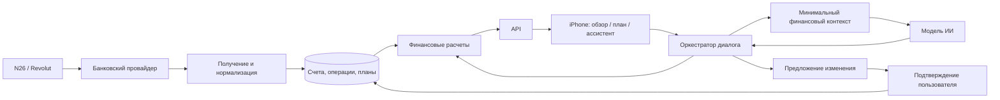

# Design: Финансовый ассистент для iPhone

Generated by /office-hours on 2026-10-04
Branch: untracked
Repo: /Users/matvii/projs/finance (Git не инициализирован; код приложения отсутствует)
Status: APPROVED
Mode: Builder
Stage: личный продукт до первого прототипа; возможность бизнеса рассматривается на будущее
Decisions: D5 — исходные положения приняты; D6 — пользователь выбрал подход B; D7 — структура трех экранов принята; D8 — документ утвержден ответом «1» (первый вариант, A)
Review status: PASS — 2 rounds, 2 issues fixed, quality 9/10; approved by user
Completion status: DONE_WITH_CONCERNS — открытые вопросы перечислены в Open Questions and Release Dependencies

## Problem Statement

Пользователь начал впервые полностью планировать личный бюджет после покупки MacBook в рассрочку на год. Учет оказался увлекательным: хочется меньше тратить, больше откладывать и видеть приближение цели. Попробованные финансовые приложения не устроили внешним видом и ощущением интерфейса.

Нужно нативное приложение для iPhone, которое автоматически собирает банковские операции, понятно показывает бюджет и позволяет обсуждать финансовые решения с ИИ. Первое применение — собственные счета пользователя в Германии. Архитектура сразу предусматривает несколько независимых пользователей и восстановление данных с сервера.

Главное обещание: «Я понимаю, где могу сэкономить, как меняется срок погашения и как новая покупка влияет на мой план».

Это подтвержденная личная потребность. Спрос со стороны других людей, готовность платить и преимущество перед существующими продуктами еще не проверены.

## What Makes This Cool

- Прогресс рассрочки выражается в понятной дате и последовательности платежей. Изменение плана сразу показывает разницу.
- Ассистент узнает смысл расходов. Пицца с друзьями может быть запланированным досугом; пользователь определяет, что ему важно сохранить.
- Вопрос «Могу ли я купить AirPods за 200 €?» превращается в сравнение вариантов с суммами, датами и явными допущениями.
- Черно-белый интерфейс показывает сначала полезный ответ, затем расчет и подробности. Чувство контроля и удовольствие от прогресса — гипотеза продукта, которую нужно проверить в повседневном использовании.

## Status Quo

1. После зарплаты пользователь выделяет деньги на обязательные расходы и подписки на карту N26.
2. Свободные деньги выделяются отдельно в Revolut.
3. В Revolut настроено еженедельное пополнение Pocket на 50 €.
4. Неиспользованные средства предназначаются для досрочного закрытия рассрочки или непредвиденных расходов.
5. При неожиданном расходе пользователь вручную переводит дополнительные деньги в Pocket.

Пользователь хочет разбирать способы экономии, видеть прогноз погашения и проверять последствия новых покупок. Время, затрачиваемое на нынешний процесс, не измерялось.

## Constraints

| Область | Решение для первой версии |
| --- | --- |
| Платформа | Нативный iPhone; основной интерфейс SwiftUI |
| География и деньги | Германия, EUR, календарь Europe/Berlin |
| Первые банки | N26 и Revolut; конкретные счета и типы данных подлежат проверке у провайдера |
| Банковские операции | Получение информации о счетах и операциях |
| Недельный бюджет | 50 € как начальное значение из текущей схемы; период и сумма редактируемы |
| Сервер | Хранит финансовую историю, настройки, планы и результаты расчетов |
| ИИ | Обсуждает данные, предлагает варианты и объясняет результаты финансового расчета |
| Дизайн | Строгий, минималистичный, черно-белый, информативный |
| Обязательная настройка | Период доходов, обязательные платежи, резерв, цели и условия рассрочки |
| Пилотный интерфейс | Русский как рабочее допущение; строки выделяются для последующей немецкой локализации |
| Первый релиз | Личный пилот через TestFlight; публичный выпуск — отдельный этап |

Автоматизация означает, что обычные банковские траты не нужно вводить по одной. Повторное банковское подтверждение доступа, уточнение неоднозначной операции и ввод условий кредита могут требовать действий пользователя. Не обещаем видимость отдельных Revolut Pocket до проверки конкретной интеграции.

## Premises

Пользователь подтвердил три положения:

1. Первая версия решает его сценарий: iPhone, N26 и Revolut, недельный бюджет, накопления и рассрочка. Операции загружаются автоматически; цели и условия рассрочки задаются при настройке.
2. Основные сценарии: подходящая экономия, прогноз погашения, последствия новой покупки.
3. ИИ учитывает личные приоритеты и объясняет расчеты. Суммы и даты рассчитывает отдельная проверяемая логика.

Если ничего не делать, банковские правила продолжат ограничивать недельные траты. Личная ценность новой версии должна проявиться в понимании последствий решений и удобстве повседневного использования.

## Research and Existing Solutions

**Общий подход:** объединение операций, разделение переводов и расходов, планирование будущих денежных потоков. Для этого проекта подход остается разумным.

**Актуальные решения:** Finanzguru на своем сайте заявляет объединение банковских счетов, автоматическую категоризацию и ИИ, который отвечает на вопросы по операциям. Комбинация банковского подключения и ИИ уже встречается у прямого немецкого конкурента. Это заявление производителя; приложение не тестировалось в этой сессии. [Finanzguru](https://finanzguru.de/)

Actual Budget дает пример существующей системы учета и подключения европейских банков. Его текущая документация описывает обновление банковских данных по действию пользователя и подключение через отдельного провайдера. Использование его готового сервера само по себе не обеспечивает выбранное обновление по расписанию. [Actual Budget: Connecting Your Bank](https://actualbudget.org/docs/advanced/bank-sync/)

**Вывод для нашего проекта:** возможное отличие — качество интерфейса, учет личных приоритетов и воспроизводимое сравнение решений. Это рабочая гипотеза. Исследование не доказало уникальность этих сценариев.

Прямой доступ стороннего сервиса к N26 требует соответствующего статуса и сертификата. Revolut также описывает Open Banking для регулируемых сторонних провайдеров. Предлагается подключение через специализированного партнера. finAPI допускает использование своего лицензированного подключения клиентами без собственных сертификатов; продукт, договор и покрытие еще не выбраны. [N26](https://support.n26.com/en-de/security/open-banking-psd2/psd2-open-banking-for-third-party-providers), [Revolut](https://developer.revolut.com/docs/api/open-banking), [finAPI](https://documentation.finapi.io/access/licensed-vs-unlicensed)

Существующего кода приложения в выбранной папке нет. Для реализации можно использовать системные компоненты iOS, банковский API провайдера и API модели ИИ.

## Approaches Considered

### Approach A: История и расчеты на iPhone

Телефон хранит данные, цели и настройки. Небольшой сервер предоставляет банковское подключение и доступ к ИИ; данные автоматически обновляются при открытии.

Плюсы: меньше серверной логики; быстрее получить личную рабочую версию. Минусы: отдельная работа для восстановления данных; расширение на несколько устройств требует дополнительных решений.

Объем M, риск средний. Грубая оценка: человек 2–4 недели, с Codex 5–10 рабочих дней. Доступ к провайдерам не входит в эту оценку.

### Approach B: Данные и расчеты на сервере — выбран пользователем

Сервер хранит историю, бюджеты, предпочтения и сценарии. Банковские обновления выполняются по расписанию. iPhone отображает данные и позволяет управлять планом.

Плюсы: восстановление аккаунта; единые расчеты и данные для разных устройств; основа для независимых пользователей. Минусы: больше серверной работы; ответственность за хранение финансовых данных и эксплуатацию.

Объем L, риск выше. Грубая оценка: человек 1–2 месяца, с Codex 2–4 недели. Это предварительная оценка разработки после подтверждения доступа к банковскому провайдеру.

Изначально был рекомендован A для личного использования. Пользователь выбрал B. Причину сверх самого выбора он не формулировал; документ не приписывает ему дополнительную мотивацию.

## Recommended Approach

Развивать выбранный B: нативный iPhone и один сервер с четко разделенными модулями. Несколько пользователей поддерживаются за счет изоляции данных; команды, совместные бюджеты, веб-клиент и другие страны — последующие задачи.

### Предлагаемая техническая основа

- SwiftUI для iPhone; локальный кеш последнего полученного состояния для чтения без сети.
- Python/FastAPI для API и финансовых модулей, PostgreSQL для хранения.
- Один серверный процесс приложения и отдельный процесс фоновых задач из того же проекта. Микросервисы не требуются.
- Планировщик на сервере запрашивает обновления с учетом квот провайдера. Предлагаемый стартовый режим — ежедневно в 07:00 Europe/Berlin плюс обновление по запросу в пределах доступных квот.
- Sign in with Apple для аккаунта; сервер проверяет полученные данные аутентификации. Банковское подключение авторизуется отдельно через форму провайдера.
- Провайдер банковского доступа и модель ИИ выбираются после проверки покрытия, договора, цены и условий обработки данных. finAPI — исследованный кандидат, не принятое решение.

Это предлагаемые технические решения для последующего /plan-eng-review. Выбор серверной архитектуры уже принят; конкретные библиотеки и размещение пока не зафиксированы.

### Модули и поток данных

Сервер формирует версию данных и версию расчета. ИИ получает факты и результаты этой версии, а пользователь может открыть основания ответа. Изменения плана применяются сервером только после подтверждения.

### Основные сущности

| Сущность | Что хранится |
| --- | --- |
| Пользователь | Идентификатор аккаунта, язык, часовой пояс, настройки |
| Банковское подключение | Провайдер, состояние согласия, идентификатор подключения, сведения об обновлении |
| Счет | Владелец, валюта, банковский идентификатор, остаток и время его актуальности |
| Операция | Идентификатор источника, сумма, дата, статус, получатель, категория, признаки перевода/возврата |
| План | Доходы, обязательства, бюджетные периоды, резерв и распределение средств на цели |
| Рассрочка | Остаток долга, ставка, даты и размеры платежей, правила досрочного погашения |
| Предпочтение | Например: сохранить встречи с друзьями; пользователь может изменить или удалить |
| Сценарий | Покупка/изменение, исходная версия данных, допущения, результат |
| Предложение | Изменения плана, состояние pending/applied/rejected, ссылка на исходный расчет |

Деньги хранятся в целых евроцентах. Процентные вычисления используют Decimal с явно заданным округлением. Аккаунт пользователя обязателен для каждой финансовой записи; сервер проверяет владельца при каждом чтении и изменении.

## Core User Flows

### 1. Настройка и ежедневный обзор

Пользователь создает аккаунт, подключает N26 и Revolut через провайдера и проверяет найденные регулярные платежи. Задает график зарплаты, недельный лимит и начало периода, минимальный резерв, цели и параметры рассрочки.

Обзор показывает:
1. Состояние подключения и время обновления каждого банка.
2. Остаток недельного бюджета.
3. Обязательные будущие платежи и зарезервированные суммы.
4. Остаток долга, прогноз даты погашения и действие «Посмотреть расчет».
5. Вход в вопрос о расходах или покупке.

Если отдельный Revolut Pocket не возвращается банковским API, приложение может рассчитывать недельный бюджет по операциям поддержанного счета и выбранному периоду. В таком режиме число называется остатком бюджета; банковский баланс Pocket не показывается как полученный из банка. Если это не обеспечивает полноту расходов, банковский этап не считается завершенным.

### 2. Оптимизация расходов с учетом смысла

Пользователь спрашивает: «Где я могу сократить расходы?». Ассистент показывает наблюдение с периодом и операциями-основаниями: например, 30 € на пиццу. Неоднозначный смысл уточняет в диалоге.

Если это встречи с друзьями, ассистент предлагает сохранить расход в плане досуга. В категории остается одна сумма; перевод категории или настройка предпочтения не создает новый расход.

Предложение показывает влияние на бюджет. Применение требует подтверждения. Сохраненные предпочтения можно посмотреть, изменить и удалить.

Первая версия предлагает варианты на основе собственного бюджета: изменить частоту расхода, размер категории или пересмотреть подписку. Поиск конкретного ресторана, цены товара и сравнение заведений выделены в следующий этап: нужны актуальные внешние данные. Ассистент первой версии не утверждает, что знает более дешевую цену без источника.

### 3. Прогноз погашения и покупка

Пользователь видит базовый график и может сравнить дополнительный платеж или разовую покупку.

Вопрос о покупке должен вернуть:
- цену, источник оплаты и период;
- влияние на обязательные платежи и минимальный резерв;
- влияние на недельный бюджет или явно выбранное исключение из него;
- дату погашения до и после изменения;
- сумму дополнительных процентов/комиссий, если она вычислима;
- допущения и сведения о данных, которых не хватает.

«Денег на счетах достаточно» и «покупка вписывается в выбранный план» показываются отдельными результатами. Перераспределение накоплений или досрочного взноса объясняется пользователю и требует его подтверждения. Лимит 50 € не увеличивается автоматически.

Каждый ответ указывает дату, до которой проверен план, и счет оплаты. Если для покупки сначала нужен перевод между своими счетами, это отдельное условие результата: деньги должны оказаться на счете оплаты до покупки.

Если цена, параметры долга, доходы или актуальность счетов неизвестны, ассистент уточняет данные и показывает условный сценарий. Положительного вывода о доступности покупки без этих данных нет.

Совет о новой рассрочке рассматривается только по отдельному вопросу пользователя и известным условиям. Полная стоимость, платежи и влияние на текущий план сравниваются тем же расчетом. Автоматическое оформление кредита и движение денег не входят в выбранный сценарий первой версии.

## Financial Calculation Rules

### Остатки, операции и переводы

- Банковский остаток на момент снимка — начальная сумма прогнозирования. История операций до этого момента не прибавляется к нему повторно.
- Загрузка операций идемпотентна: повторный импорт не создает повторный расход.
- Внутренние переводы между собственными счетами N26/Revolut меняют размещение денег и исключаются из суммарных доходов и расходов.
- Если обе стороны перевода не найдены и принадлежность получателя неизвестна, операция требует проверки; безопасный для покупки остаток не завышается.
- Проведенные операции и ожидающие списания имеют разные статусы. Недельный бюджет учитывает ожидаемый расход один раз; после проведения его запись обновляется.
- Если доступный банковский остаток уже учитывает ожидающее списание, оно не вычитается из этого остатка второй раз. Использование posted/available balance фиксируется адаптером провайдера.
- Возврат связывается с исходным расходом, если это возможно; иначе пользователь подтверждает классификацию. Возврат не считается зарплатой.
- Платеж кредитору является денежным оттоком. Его основная часть уменьшает долг, проценты/комиссии учитываются отдельно; снижение долга не создает дополнительного оттока поверх банковского платежа.

### Денежный план

Прогноз строится по датированным денежным событиям: подтвержденным будущим доходам, платежам, плановым тратам и выбранным изменениям. Денежный остаток проверяется после каждого события, чтобы положительный итог месяца не скрывал нехватку денег до зарплаты.

Минимальный резерв задает пользователь. Средства на обязательства и цели выделяются без пересечения: одна сумма не может одновременно считаться резервом, доступным расходом и досрочным платежом.

Сценарий покупки указывает, из какого выделенного бюджета или свободной суммы списывается цена. Если требуется перенос средств с цели, расчет показывает это как явное изменение плана.

Начальное недельное значение — 50 €. Неделя задается датой начала и шагом семь дней. Неиспользованный бюджет по рабочему допущению не увеличивает лимит следующей недели; остаток может пополнять цель только после выбора пользователя. Правило переносов подтверждается в настройке.

### Какие операции входят в недельные 50 €

Для пилота предлагаются следующие правила; состав счетов и категорий пользователь подтверждает при настройке:

- Бюджет относится к выбранному счету для повседневных трат в Revolut. Если провайдер возвращает отдельный Pocket и его операции, можно выбрать его; иначе используются операции выбранного счета и отмеченные категории повседневных расходов.
- Покупки в выбранных категориях уменьшают бюджет. Подписки, обязательные платежи, погашение рассрочки и внутренние переводы учитываются в денежном плане отдельно. Перевод 50 € в Pocket не считается расходом.
- Расход «пицца с друзьями» остается в недельном бюджете, даже если пользователь хочет его сохранить. Выведение его в отдельный бюджет досуга возможно только как подтвержденное перераспределение той же суммы. Неоднозначная операция помечается для уточнения; неполный охват расходов виден в обзоре и блокирует безусловный ответ о покупке.
- Неделя расхода определяется датой операции в Europe/Berlin. Если такой даты нет, используется дата проведения с явной отметкой. Ожидающий расход резервируется по дате авторизации; после связывания с проведенной операцией это один расход с сохраненным периодом. Исправление даты источником пересчитывает затронутые периоды и показывается пользователю.
- Возврат уменьшает исходный расход в его исходной неделе, максимум на еще не возвращенную сумму. Возврат прошлой недели не увеличивает лимит текущей; его денежное поступление отражается в остатке счета. Несвязанный возврат требует классификации перед пересчетом бюджета.
- Отмененное ожидающее списание освобождает резерв исходной недели и становится нулевым расходом. Доступные для покупки деньги определяются актуальным банковским остатком; освобождение бюджетного резерва само по себе не доказывает доступность денег в банке.

### Горизонт и доступность денег по счетам

Для сравнения покупки оба варианта рассчитываются до одной даты: более поздней даты полного погашения в базовом и измененном графике, но не раньше следующего подтвержденного дохода. Если пользователь включает в сравнение цель с более поздним сроком, горизонт продлевается до этого срока. Ответ формулируется как «вписывается в план до [дата]»; события после этой даты не считаются проверенными. Если график не погашает долг или даты и будущие доходы неизвестны, точного положительного результата нет.

Проверяются обязательства, резерв и выбранные цели на всем этом промежутке, после каждого денежного события. Проверка выполняется и по совокупности средств, и по конкретным счетам оплаты. Достаточная сумма на другом счете не закрывает нехватку на счете списания без явно заданного перевода до нужного срока. Плановый перевод показывается как необходимое действие пользователя; приложение не выполняет его.

Если известен только день события, консервативный расчет ставит списания раньше поступлений того же дня. Если результат зависит от времени поступления или еще не определенного источника оплаты, он остается условным с объяснением. Точные правила порядка событий и связи переводов детализируются в /plan-eng-review.

### Рассрочка

Параметры: текущий остаток, ставка, дата следующего платежа, регулярный платеж, дополнительные взносы и условия досрочного погашения. Банковские списания сами по себе не доказывают ставку и остаток долга.

Первая версия поддерживает расчет для известной рассрочки с фиксированными условиями и проверенным способом начисления процентов. Варианты 0 % и фиксированной ставки описываются отдельными расчетными профилями; профиль с процентами должен воспроизводить договорный график до использования в советах. Неизвестный договор или неподдержанный способ начисления дает условный сценарий, а не точную обещанную дату.

Последний платеж ограничивается остатком долга и начисленными суммами. При отрицательном денежном остатке сценарий признается невыполнимым, даже если график долга математически сходится.

### Проверяемый пример из эскиза

Это учебные данные, не реальные условия пользователя: остаток 1 200 €, ставка 0 %, регулярный платеж 200 €, дополнительный 100 €, ближайший платеж 6 октября 2026; досрочное погашение разрешено без комиссии.

| Дата | Базовый платеж | Остаток | Покупка заменяет дополнительные взносы октября и ноября | Остаток |
| --- | ---: | ---: | ---: | ---: |
| 6 октября | 300 € | 900 € | 200 € | 1 000 € |
| 6 ноября | 300 € | 600 € | 200 € | 800 € |
| 6 декабря | 300 € | 300 € | 300 € | 500 € |
| 6 января | 300 € | 0 € | 300 € | 200 € |
| 6 февраля | — | 0 € | 200 € | 0 € |

Отдельно предполагается, что 200 € на покупку доступны из суммы, выделенной на два досрочных взноса, и обязательства/резерв сохранены. Таблица доказывает только изменение графика долга. Возможность покупки в реальном бюджете требует полного денежного плана.

## AI Behavior and Data Handling

Ассистент имеет три основных действия: запросить финансовые факты, вызвать расчет сценария, подготовить предложение изменения. Ответ с суммами и датами опирается на результат расчетного модуля и связан с версией исходных данных.

Назначение платежа, имя получателя и другой банковский текст считаются данными. Инструкции из такого текста не исполняются. ИИ не получает банковские токены и не может напрямую изменять финансовые записи или выполнять платежи.

Перед передачей финансового контекста внешнему ИИ приложение сообщает получателя, категории данных и цель передачи и получает отдельное явное согласие. Базовый обзор и расчеты доступны без этого согласия. Apple прямо требует раскрывать передачу персональных данных стороннему ИИ и получать разрешение. [Apple App Review Guidelines, 5.1.2](https://developer.apple.com/app-store/review/guidelines/#data-use-and-sharing)

Передается минимальный контекст для вопроса: суммы, категории, необходимые даты, выбранные предпочтения и расчетные результаты. Номер счета, банковские секреты и ненужные описания операций исключаются. Конкретный поставщик ИИ и условия хранения запросов остаются условием выбора.

Секреты банковского провайдера хранятся на сервере отдельно от данных приложения, с шифрованием и ограничением доступа. Транспорт использует TLS. На телефоне секреты сессии хранятся в Keychain; история в кеше доступна только владельцу сессии. Журналы эксплуатации не содержат полных банковских описаний и текста финансовых диалогов.

При выходе из аккаунта или смене пользователя локальный кеш и токены предыдущей сессии удаляются. До подключения реальных финансовых данных /plan-eng-review фиксирует сроки хранения, удаления резервных копий и отзыва серверных сессий; эти эксплуатационные правила пока не определены.

В приложении предусмотрены экспорт собственных данных, отключение банка и удаление аккаунта. Отключение прекращает дальнейший сбор; удаление аккаунта удаляет активные данные и планируется с учетом согласованного срока удаления резервных копий. Возможность удаления аккаунта из приложения требуется Apple для приложений с созданием аккаунта. [Apple App Review Guidelines, 5.1.1](https://developer.apple.com/app-store/review/guidelines/#data-collection-and-storage)

## Visual Design and Interaction States

Утвержденная структура: «Обзор», «План», «Ассистент». [HTML-эскиз](2026-10-04-wireframe.html). Пользователь подтвердил структуру, не финальное визуальное оформление. Скриншот не сделан: браузерный просмотр в среде недоступен.

Направление: системный шрифт iOS, крупные суммы, табличное выравнивание чисел, тонкие разделители, свободное пространство, белый/черный/серый. Текстовые метки передают состояния независимо от цвета. Читаемость проверяется с Dynamic Type и VoiceOver. Длинные названия получателей и категорий переносятся; сумма остается различимой.

| Состояние | Что видит пользователь |
| --- | --- |
| Первый запуск | Понятная настройка счетов и плана; до импорта нет вымышленных нулей |
| Загрузка | Последние известные данные с меткой обновления; первый импорт имеет отдельный статус |
| Успех | Сводка и расчет с периодом и источниками |
| Нет операций | Сообщение о покрытом периоде; пустота не означает отсутствие обязательств |
| Один банк недоступен | Сводка помечена неполной; вывод о доступности покупки приостановлен |
| Нет сети | Кеш и время актуальности; изменения плана доступны после подключения |
| Истек доступ к банку | Кнопка повторного подтверждения; история остается доступной |
| ИИ недоступен | Обзор и финансовый расчет работают; вопрос можно повторить |
| Недостаточно условий кредита | Запрос параметров; дата показана только как условный пример |
| Изменились данные после диалога | Предложение пересчитывается перед подтверждением; старый результат не применяется |
| Нехватка денег по сценарию | Конкретная дата и сумма дефицита, без положительного вывода о покупке |

Рабочая политика актуальности для пилота: если необходимый счет не обновлен более 24 часов или покрытие неполно, положительный ответ о доступности покупки блокируется. Это продуктовый порог, не требование банка; его нужно согласовать с реальной частотой доступных данных.

## Open Questions and Release Dependencies

| Вопрос | Как разрешается | Что зависит от ответа |
| --- | --- | --- |
| Доступ к N26 и Revolut, история, pending и остатки | Проверка конкретного провайдера на типах счетов пользователя | Банковское подключение |
| Отдельный Revolut Pocket | Проверка возвращаемых счетов и полноты операций; при необходимости вычисляемый бюджет | Название и точность недельной суммы |
| Цена, договор, квоты провайдера | Подтверждение предложения выбранного партнера | Автоматический сбор и экономика сервера |
| Условия MacBook | Договорный график, ставка, комиссии и досрочное погашение | Реальная дата погашения |
| Доходы, резерв, распределение средств | Настройка пользователем | Ответы о доступности покупки |
| Провайдер ИИ и хранение данных | Выбор и раскрытие условий до включения ИИ | Диалог по финансовым данным |
| Окончательный UI и имя приложения | /plan-design-review; название выбирает пользователь | Визуальный дизайн и публикация |
| Минимальная версия iOS и язык публичного релиза | /plan-eng-review с учетом телефона и аудитории | Сборка и релизная конфигурация |
| Публикация финансового приложения | Проверка роли издателя, прав доступа и применимости требований Apple к точным функциям | Внешний TestFlight и App Store |

Apple имеет отдельное правило 3.2.1(viii) для финансовых приложений и управления деньгами. До внешнего выпуска нужно выяснить, как выбранные функции и банковский договор соответствуют этому правилу. Подключение через провайдера само по себе не доказывает выполнение всех требований к публикации. [Apple App Review Guidelines, 3.2.1](https://developer.apple.com/app-store/review/guidelines/#other-business-model-issues)

Работа с демонстрационными данными позволяет проектировать интерфейс до проверки банков, но не завершает требование автоматического учета. Зависимости выше не считаются решенными этой сессией.

## Success Criteria

1. На собственных N26 и Revolut обычные траты появляются после разрешенного обновления без ручного ввода каждой операции. Время обновления видно.
2. Повторный импорт, переход pending в booked, перевод между своими счетами и возврат не завышают расходы или доходы.
3. Для недели с лимитом 50 € и расходом 18 € обзор показывает 32 €. Обязательные платежи и внутренние переводы не уменьшают этот лимит; связанный возврат и отмена ожидающего расхода пересчитывают исходную неделю. Правило переноса применено согласно настройке.
4. Ассистент по фразе «встречаюсь с друзьями» предлагает сохранить соответствующий расход, показывает основания и меняет план только после подтверждения.
5. Учебный график выше воспроизводится: 6 января 2027 в базе, 6 февраля в сценарии покупки. Реальный график воспроизводит известные условия договора.
6. Вопрос о покупке объясняет влияние на обязательства, резерв, недельный бюджет и цель до указанной даты. Учитываются счет оплаты и последовательность событий; зависимость от перевода или времени дохода видна как условие. При неполных данных запрашивается недостающее.
7. После переустановки пользователь восстанавливает серверные данные. Другой аккаунт не получает доступ к ним.
8. ИИ можно отключить; обзор и расчеты остаются доступными. Пользователь может экспортировать данные и удалить аккаунт.
9. Пилот устанавливается на настоящий iPhone; без подсказок пользователь проходит три основных сценария.
10. За две недели собственного использования фиксируются удобство, исправления классификации, полезные ответы и ошибки прогнозирования. Количественная экономия и спрос других пользователей на этом этапе не считаются доказанными.

Это критерии будущей реализации. Приложение и его поведение в этой сессии не тестировались.

## Distribution Plan

Личный пилот — TestFlight после создания проекта и подготовки подписанной сборки. TestFlight позволяет распространять бета-версии; внешний пилот требует процесса Apple для внешних тестеров. [Apple TestFlight](https://developer.apple.com/testflight/)

Предлагаемый поток доставки после отдельного плана реализации:
1. Приватный Git-репозиторий приложения и сервера.
2. CI для проверки финансовых правил, изоляции аккаунтов и сборки.
3. Серверный staging с демонстрационными данными и миграциями базы.
4. Подписанная iOS-сборка через CI macOS/Xcode Cloud в App Store Connect.
5. Личный TestFlight; внешний пилот после разрешения релизных зависимостей.
6. App Store после пилота и проверки требований к публикации.

Apple Developer, подпись, хостинг и банковский доступ не настроены. Этот документ определяет маршрут распространения; создания аккаунтов, покупки услуг или публикации не выполнялось.

## Next Steps

1. В /plan-eng-review проверить банковскую осуществимость и определить минимальный законченный серверный поток для трех сценариев. Детализировать договорный расчет, порядок денежных событий, модель резервирования, обновление операций и сроки хранения/удаления данных до подключения реальных счетов.
2. В /plan-design-review проработать черно-белый интерфейс на основе утвержденной структуры, включая состояния неполных данных.
3. После плана реализации собрать вертикальный сценарий: подключение → нормализация → обзор → один расчет покупки → объяснение ИИ.
4. Воспроизвести расчет на демонстрационных примерах и реальном известном договорном графике, затем провести личный двухнедельный пилот.
5. После личного пилота определить, какие сценарии полезны другим людям. Монетизация и расширение банков требуют отдельного решения.

## The Assignment

Подготовить один локальный набор для проверки будущего продукта: обезличенную историю операций за последние 30 дней, условия рассрочки, даты доходов и выбранный резерв. Отметить в этом наборе внутренние переводы и один расход, который хочется сохранить.

Использовать локальный набор, чтобы вручную записать ожидаемый ответ на три согласованных сценария и затем сравнить с будущей реализацией.

## What I noticed about how you think

- Ты связал идею с конкретным изменением поведения: рассрочка заставила «полностью рассчитать бюджет». Это описывает существующую личную ситуацию.
- Ты назвал точный механизм: «50 € в неделю» в Revolut Pocket. От него можно отталкиваться при проектировании и проверке расчета.
- В примере с пиццей ты объяснил смысл траты: «встречаюсь с друзьями». Поэтому модель предпочтений нужна рядом с категориями расходов.
- Твой запрос к виду интерфейса конкретен: «минималистично, строго, красиво», «черно-белый», «информативный». Структура согласована; визуальное качество еще предстоит создать.

## Independent Spec Review

Независимый рецензент прочитал только документ, без истории обсуждения. Проведено два раунда проверки по полноте, согласованности, ясности, объему и осуществимости.

В первом раунде выявлены и исправлены два пробела: границы недельного бюджета и горизонт проверки покупки с доступностью денег по отдельным счетам. Во втором раунде все пять измерений получили PASS; оценка качества документа — 9/10. Оставшихся замечаний рецензента нет. Банковские, договорные и релизные зависимости из раздела Open Questions остаются открытыми; проверка документа не подтверждает работоспособность еще не созданного приложения.

Метрики сохранены локально в [2026-10-04-spec-review.jsonl](2026-10-04-spec-review.jsonl), поскольку стандартный домашний каталог аналитики недоступен для записи.

## Artifact Location and Handoff

Документ сохранен в разрешенной рабочей папке: /Users/matvii/projs/finance/docs/office-hours/2026-10-04-iphone-finance-design.md.

Обычные runtime-помощники gstack и каталог ~/.gstack в этой среде отсутствуют; запись в пользовательский домашний каталог не разрешена профилем среды. Для следующего навыка передайте путь к этому документу явно. Автоматическое обнаружение через ~/.gstack не настроено. Отдельный sections/design-and-handoff.md отсутствует в установленном пакете; применены соответствующие разделы основного SKILL.md.

Документ утвержден пользователем. Следующий рекомендуемый этап — /plan-eng-review с явным путем к этому файлу; затем /plan-design-review. Разработка приложения начинается после отдельного плана реализации.
